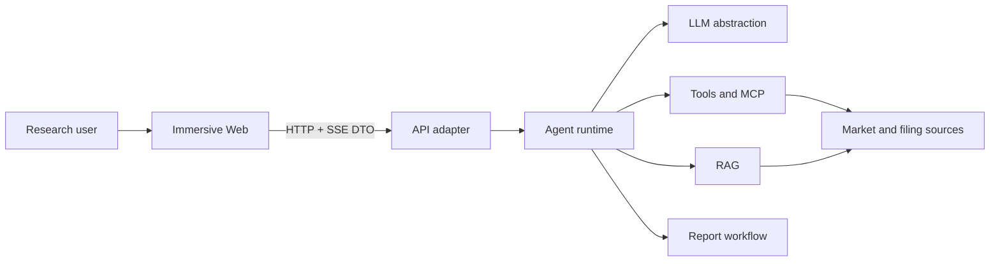

# Immersive Architecture

## 1. Goals

Immersive is a financial-research Agent workspace. The architecture optimizes for explainable runs, replaceable data/model adapters, structured failures, and small task-local context for human and AI contributors.

## 2. System Context

## 3. Dependency Direction

- `apps/web` depends only on browser libraries and `@aiagent/types`.
- `apps/api` is a transport/composition adapter. It may compose runtime packages but must not implement Agent, RAG, tool, workflow, or report rules.
- `apps/cli` is a second composition root and local harness. It shares the same `agentLoop` kernel with `apps/api` but uses the terminal as its transport layer (no HTTP/SSE/worker). It selects a real model via `createOpenAiCompatibleRuntime` and assembles `createDefaultToolRegistry` with a `FinancialDataSource`, proving the kernel can run headless.
- `packages/ai` owns the LLM abstraction: `Message` types, `AssistantMessageEvent`, provider adapters, and `stream` / `streamSimple`. It has no project dependencies.
- `packages/agent` owns the ReAct loop (`agentLoop` / `agentLoopContinue`), `AgentTool` contract, and tool execution; report generation is exposed to the loop as the `generate_report` tool (`packages/report`), not orchestrated by the API layer.
- `packages/tools`, `packages/rag`, `packages/workflow`, `packages/report`, and `packages/mcp` own their bounded contexts.
- `packages/trace` owns the minimal run-event type contract and cross-boundary value redaction; it no longer owns a separate recorder/store.
- `packages/security` owns prompt-injection assessment and untrusted-context encapsulation; it has no business dependencies and can be used by agent, rag, tools, and report boundaries.
- `packages/types` owns transport contracts only and has no runtime dependencies.
- `packages/conversation` owns the mapping between pi `Message` and the linear message store; `packages/database` implements the PostgreSQL adapter without depending on `@aiagent/ai`.
- Packages import other packages through declared public entrypoints. Deep cross-package imports and dependency cycles are forbidden.

## 4. Internal Package Shape

Large bounded-context packages use these responsibilities when needed:

- `domain`: stable concepts, invariants, and policies.
- `application`: use cases and ports.
- `adapters`: replaceable infrastructure such as in-memory stores, providers, and renderers.
- package entrypoint: the smallest supported public API.

The Web is feature-first: `app`, `features`, `entities`, and `shared`. A feature may contain `ui`, `model`, `api`, and `lib`; empty ceremonial folders are not created.

## 4.1 Context Assembly & Budget Observability

`packages/agent` 的分层上下文装配器（`context-assembly.ts`）负责把工作记忆 / 检索记忆按 token 预算分级
拼进 LLM 上下文；它**只接受 provider 回调，不 import 任何 memory 包**，记忆来源（短期状态 / RAG / 向量库）
在集成时以回调注入，装配内核独立演化。

长期情节记忆（`@aiagent/memory` 的 `EpisodeMemory`）默认存于进程内（`InMemoryMemoryStore` / `JsonlMemoryStore`），
跨实例共享由 `PgVectorMemoryStore` 提供——它实现同一 `MemoryStore` 接口、通过工厂 `createMemoryStore({ kind: "pg" })`
选择，调用方零改动；数据源（pg.Pool）以注入的 `QueryExecutor` 接口传入，向量检索用本地确定性 32 维 embedder
（hashing trick，维度对齐 `POSTGRES_RAG_VECTOR_DIMENSIONS`），落库表为 `memory_episodes`（迁移 `0270_memory_episodes.sql`）。
工作记忆（`WorkingMemory`）保持进程内、不在 PG，符合其短期状态语义。详见 ``。

装配层新增**预算可观测化**：`createContextAssemblyTransform` 每次调用都通过 `ContextAssemblerOptions.recordBudgetMetric`
回调 emit 一份 `ContextBudgetReport`（含 `budgetTokens` / `injectedTokens` / kept·discarded 计数 / `memoryHitRate` /
`discardRate` / `tier`，分母统一 `max(x,1)` 保证 [0,1] 且 0 分母定义良好）。指标通过回调流出，不耦合运行层；
`summarizeBudgetReports` 供 eval/dashboard 聚合平均命中率、平均丢弃率与超预算次数（详见
``）。

该预算指标经**受控钩子**投影进运行事件：`RunServiceDependencies.budgetMetricSink` 收集每次 `recordBudgetMetric`
回调产出的 `ContextBudgetReport`，由 `projectContextBudgetSummary`（复用 `summarizeBudgetReports`）在 `agent_end`
并入 `cost_summary.contextBudget` 段（契约见 trace 的 `CostSummaryEvent.payload`）。run-service 不自行创建
context-assembly（调用方显式注入 `contextAssemblyTransform` 才启用），故常规 run 省略该段——有意的分层，非缺陷。

## 4.2 Workflow 顺序运行时（入口瘦身）

`packages/workflow` 的顺序节点运行时原本集中在 `src/index.ts`（772 行，且为包内唯一源文件），超出「单文件 ≤500 行」
纪律。已按内聚域拆分、公共 API 零改动：`types.ts`（10 个公共类型契约）、`node-state.ts`（节点 DTO 构造与失败态）、
`events.ts`（事件构造、sink 发射、输入/输出低风险摘要）、`runtime-helpers.ts`（执行/超时/终止/预算/耗时等引擎原语
与 `DEFAULT_MAX_STEPS`）、`run-engine.ts`（`runSequentialWorkflow` 编排 + `createWorkflowPackageSummary`），`index.ts`
退化为 barrel 再导出。外部消费方（`@aiagent/report` 的 `run-report-workflow`、workflow 测试）只依赖公共符号，
拆分对它们透明。详见 ``。

## 5. Runtime View

`apps/api/src/server.ts` 是服务端（HTTP/SSE）的生产 composition root：所有 PostgreSQL adapter 在此注入，领域 package 不读取 `DATABASE_URL`。`apps/cli/src/index.ts` 是终端 harness 的组合根，二者共用同一 `agentLoop` 内核、仅运输层不同。PostgreSQL 是 Identity、Conversation/Message、Run/RunEvent、RAG document/chunk/vector、Citation、Workflow 与 Artifact metadata 的唯一事实源；内存只保留 live event bus、execution registry 的 `AbortController` 和 microtask scheduler，内存 repository 只能由测试显式创建。

1. 启动顺序固定为：migration 状态检查（存在 pending migration 直接拒绝启动）→ Fastify ready（陈旧 Run 恢复，把超时未终态的 Run 落库为 `run_interrupted` 失败）→ listen 接流量。readiness 同时验证 provider 配置、PostgreSQL 连通性和 artifact storage 根目录。
2. Web creates a run through the API.
3. API route delegates creation to `RunApplicationService`; PostgreSQL atomically creates the Run and an idempotent user message.
4. The application service schedules execution; `agentLoop` consumes `AssistantMessageEvent`s from `packages/ai` and emits one canonical run event stream. RAG, report/workflow, and MCP extensions emit their own events into the same stream via the run service.
5. `packages/trace` redacts sensitive values before persistence; `RunStore` appends each event to `run_events` in a transaction that also updates the Run snapshot and assigns a continuous sequence. Only after commit does the event bus fan out live events. 总线默认是进程内内存实现（`createInMemoryRunEventBus`）；当配置 `REDIS_URL` 时升级为 Redis pub/sub 支撑的跨实例总线（`createRedisRunEventBus` + `createRedisPubSubTransport`，发布/订阅两条独立连接、懒连接），用 `instanceId` 信封抑制 self-echo，保证每个订阅者恰好收到一次。
6. Web projects events into assistant-message progress and an on-demand detail panel.
7. A terminal event (`agent_end` or `run_error`) provides the final structured result. Explicit cancellation propagates through an execution registry owned `AbortSignal`.
8. SSE replays persisted events, subscribes to the event bus (Redis pub/sub when deployed multi-instance, else process-local), buffers live delivery during a catch-up query, then merges and drains only continuous sequences. A later live gap triggers another persisted-event query. 单连接背压由 `ordered-run-event-stream.ts` 承担（`write()` 返回 `false` 时暂停 drain，`reply.raw` 的 `'drain'` 事件触发 `resume()` 恢复，pending buffer 零丢弃）。`RunStore`, `RunEventBus`, and `RunScheduler` remain separate ports.
9. Graceful shutdown（SIGTERM/SIGINT）：先停止接收新 Run（提交返回 503），中断在途执行并有限 drain（`SHUTDOWN_DRAIN_MS`，默认 10s），仍未终态的 Run 复用陈旧恢复路径落库为 `run_interrupted`，最后关闭 SSE 连接、QQ channel 与连接池。

## 6. Quality Attributes

- Explainability: every meaningful model, retrieval, tool, workflow, and artifact transition is observable through the canonical run event stream.
- Safety: untrusted inputs are validated, sensitive values are redacted, and tool execution follows explicit allowlists and schema validation.
- Replaceability: provider-specific behavior stays behind ports and adapters.
- Evolvability: dependency rules, strict types, tests, and documentation checks prevent architecture drift.
- Data honesty: built-in data tools (`market_data` / `filing_search` / `financial_metric`) route through the `FinancialDataSource` port. When no real source is configured they return a structured `configuration_error` rather than fabricated values, so the UI/CLI never presents fake numbers as live market data. The runtime no longer ships a mock LLM; the only non-real model is a test-only double used by integration tests.

## 7. Decisions and Risks

Architecture-significant decisions live in `docs/decisions/`. Run snapshots/events, messages, citations, RAG ingestion lineage, workflows, artifact metadata, and vector indexes are persisted in PostgreSQL. Only live event subscribers, cancellation controllers, and the microtask scheduler remain process-local. A restart marks only stale non-terminal Runs as an explainable `run_interrupted` failure; automatic execution continuation remains a worker/queue follow-up. Root-level end-to-end evidence (restart, SSE reconnect, cross-user isolation, idempotency races, `pg_dump` restore, PostgreSQL outage, graceful shutdown) lives in `test/verify-runtime-integration.mjs`.

## 8. Multi-Agent Team & Cost Guardrail

`packages/agent/src/team/` 实现 Supervisor 编排（多窗口拓扑：TeamCreate 建子代理、SendMessage 派发任务）。每个子代理 = 一次独立 `agentLoop`（独立 context + EventStream + 独立 token 预算），复用内核零改动。

多代理 token 成本约单体 15×，必须有成本收口证据（对应 `docs/v1.2/01-agent-engineering-philosophy.md` §4 P0）：

- **跑中成本护栏**：`runMember` 注入 `AgentLoopConfig.shouldStopAfterTurn` 钩子（来自 `team/budget.ts`），每轮 `turn_end` 用 `AsyncMutex` 串行化「读累加器 → 判定 → 提交写入」防止并发突破团队 ceiling，并采用 pre-commit 判定使团队累计 `totalTokens/totalCost` 严格不超 ceiling；触发 per-member 上限（`maxCostPerMember` / `maxTokensPerMember`）或团队总 ceiling（`maxCostTotal` / `maxTokensTotal`）或墙钟 deadline 时干净停止。墙钟 deadline 由护栏闭包查时钟实现（起点在 `semaphore.acquire()` 成功之后），`agent-loop.ts` 不消费 `deadlineMs`、内核零改动。
- **派发前估算**：纯函数 `createBudgetGuard(model, estimatedTokens, config, accumulator)` 用 `model.cost`（$/百万 token）× 估算 token 数，独立于实际 usage 预先拒绝超预算任务，便于单测。
- **最小并发**：`maxConcurrentMembers`（默认 1=顺序）+ `Semaphore` + `mapWithConcurrencyLimit` worker 池（`team/concurrency.ts`，另含 `AsyncMutex`），`runMembers` 扇出限制在飞数。
- **可观测**：`SubagentResult` / `TeamMember` 含 `usage` / `budgetExceeded`（未配置预算则不渲染用量行）；`getTeamView` 渲染每成员成本与团队总计；`TeamController.getBudgetAccumulator()` 暴露团队累计供断言。多代理成本还经 **RunEvent 投影闭环** 进入 `cost_summary.team` 段：`projectTeamCostSummary(teamState)`（agent 包 `team/run-event.ts`）把各成员用量对齐 trace 契约，`run-service` 在 `tool_execution_end` 受控累加 SendMessage 的 `SubagentResult`、`agent_end` 仅当真实存在 team 数据才并入 `team` 段（契约见 trace 的 `CostSummaryEvent.payload`）。常规 run 未装配 team 工具故省略该段——有意的分层，非缺陷。
- **SLO / 容量证据**（闭合 docs/v1.2 §3 差距#7「无真实容量/SLO/成本证据」）：成本数字已由 `cost_summary` 覆盖，本切片补 `durationMs / turnCount / outcome / activeRuns / peakConcurrency` 五类时延/成功率/并发证据。`agent` 包 `team/slo.ts` 的纯函数 `summarizeSlo(runs)` 对多批 `RunSloSummary` 聚合出成功率、duration 的 p50/p95、均值成本/turn、跨批 `maxActiveRuns/maxPeakConcurrency`；`run-service` 在 `agent_end` 受控并入这些字段（仅有限有效值才写）；多代理 `team.peakConcurrency` 由 controller 维护的 runningMembers 在飞峰值投影。数据化证据脚本见 `test/capacity-slo-evidence.mjs`。

详见 ``、`` 与 ``。
