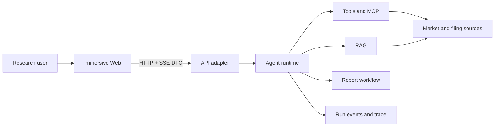

# Immersive Architecture

## 1. Goals

Immersive is a financial-research Agent workspace. The architecture optimizes for explainable runs, replaceable data/model adapters, structured failures, and small task-local context for human and AI contributors.

## 2. System Context

## 3. Dependency Direction

- `apps/web` depends only on browser libraries and `@aiagent/types`.
- `apps/api` is a transport/composition adapter. It may compose runtime packages but must not implement Agent, RAG, tool, workflow, or report rules.
- `packages/agent` owns an end-to-end research run and coordinates report-mode execution.
- `packages/tools`, `packages/rag`, `packages/workflow`, and `packages/report` own their bounded contexts.
- `packages/trace` owns event recording, sanitization, subscription, and trace projections.
- `packages/types` owns transport contracts only and has no runtime dependencies.
- Packages import other packages through declared public entrypoints. Deep cross-package imports and dependency cycles are forbidden.

## 4. Internal Package Shape

Large bounded-context packages use these responsibilities when needed:

- `domain`: stable concepts, invariants, and policies.
- `application`: use cases and ports.
- `adapters`: replaceable infrastructure such as in-memory stores, providers, and renderers.
- package entrypoint: the smallest supported public API.

The Web is feature-first: `app`, `features`, `entities`, and `shared`. A feature may contain `ui`, `model`, `api`, and `lib`; empty ceremonial folders are not created.

## 5. Runtime View

`apps/api/src/server.ts` 是唯一生产 composition root：所有 PostgreSQL adapter 在此注入，领域 package 不读取 `DATABASE_URL`。PostgreSQL 是 Identity、Conversation/Message、Run/RunEvent、Trace、Approval、RAG document/chunk/vector、Citation、Workflow 与 Artifact metadata 的唯一事实源；内存只保留 live event bus、execution registry 的 `AbortController` 和 microtask scheduler，内存 repository 只能由测试显式创建。

1. 启动顺序固定为：migration 状态检查（存在 pending migration 直接拒绝启动）→ Fastify ready（陈旧 Run 恢复，把超时未终态的 Run 落库为 `run_interrupted` 失败）→ listen 接流量。readiness 同时验证 provider 配置、PostgreSQL 连通性和 artifact storage 根目录。
2. Web creates a run through the API.
3. API route delegates creation to `RunApplicationService`; PostgreSQL atomically creates the Run, idempotent user message, and reserved assistant message.
4. The application service schedules execution and Agent/Report emit one canonical event stream; the Trace recorder redacts it before any persistence boundary.
5. PostgreSQL locks the Run and Trace rows, appends each Trace event and its Run `trace_event` projection in one transaction, and assigns continuous sequence values; only after commit does the in-memory bus fan out live events.
6. Approval decision 与 approval decided trace event 在同一数据库事务提交（复用 Trace sequence 分配）；Run 已终态时只提交决定，幂等重放不重复追加事件，提交后才向 live bus fan-out。
7. Web projects events into assistant-message progress and an on-demand detail panel.
8. A terminal event provides the final structured result. Explicit cancellation propagates through an execution registry owned `AbortSignal`.
9. SSE replays persisted events, subscribes to the process-local bus, buffers live delivery during a catch-up query, then merges and drains only continuous sequences. A later live gap triggers another persisted-event query. `RunStore`, `RunEventBus`, and `RunScheduler` remain separate ports.
10. Trace persistence is an observability side path: a database failure emits a structured internal warning and marks the terminal result `tracePersistence: degraded` without exposing the raw exception or failing the Agent answer.
11. Graceful shutdown（SIGTERM/SIGINT）：先停止接收新 Run（提交返回 503），中断在途执行并有限 drain（`SHUTDOWN_DRAIN_MS`，默认 10s），仍未终态的 Run 复用陈旧恢复路径落库为 `run_interrupted`，最后关闭 SSE 连接、QQ channel 与连接池。

## 6. Quality Attributes

- Explainability: every meaningful model, retrieval, tool, workflow, approval, and artifact transition is observable.
- Safety: untrusted inputs are validated, sensitive values are redacted, and approvals bind to run and input digest.
- Replaceability: provider-specific behavior stays behind ports and adapters.
- Evolvability: dependency rules, strict types, tests, and documentation checks prevent architecture drift.
- Demo honesty: mock data is labelled and never presented as live market data.

## 7. Decisions and Risks

Architecture-significant decisions live in `docs/decisions/`. Run snapshots/events, Trace summaries/events, messages, approvals, citations, RAG ingestion lineage, workflows, artifact metadata, and vector indexes are persisted in PostgreSQL. Only live event subscribers, cancellation controllers, and the microtask scheduler remain process-local. A restart marks only stale non-terminal Runs as an explainable `run_interrupted` failure; automatic execution continuation remains a worker/queue follow-up. Root-level end-to-end evidence (restart, SSE reconnect, cross-user isolation, idempotency races, `pg_dump` restore, PostgreSQL outage, graceful shutdown) lives in `test/verify-runtime-integration.mjs`.
