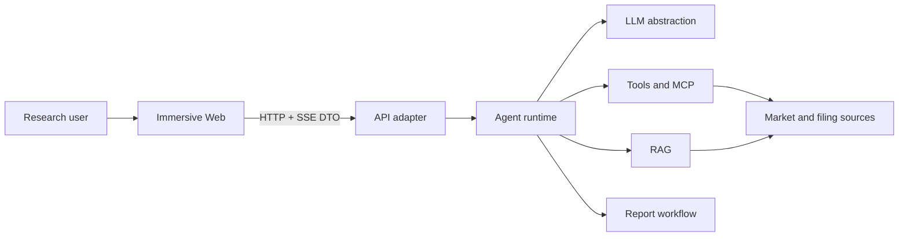

# Immersive Architecture

## 1. Goals

Immersive is a financial-research Agent workspace. The architecture optimizes for explainable runs, replaceable data/model adapters, structured failures, and small task-local context for human and AI contributors.

## 2. System Context

## 3. Dependency Direction

- `apps/web` depends only on browser libraries and `@aiagent/types`.
- `apps/api` is a transport/composition adapter. It may compose runtime packages but must not implement Agent, RAG, tool, workflow, or report rules.
- `apps/cli` is a second composition root and local harness. It shares the same `agentLoop` kernel with `apps/api` but uses the terminal as its transport layer (no HTTP/SSE/worker). It selects a real model via `createOpenAiCompatibleRuntime` and assembles `createDefaultToolRegistry` with a `FinancialDataSource`, proving the kernel can run headless.
- `packages/ai` owns the LLM abstraction: `Message` types, `AssistantMessageEvent`, provider adapters, and `stream` / `streamSimple`. It has no project dependencies.
- `packages/agent` owns the ReAct loop (`agentLoop` / `agentLoopContinue`), `AgentTool` contract, and tool execution; report generation is exposed to the loop as the `generate_report` tool (`packages/report`), not orchestrated by the API layer.
- `packages/tools`, `packages/rag`, `packages/workflow`, `packages/report`, and `packages/mcp` own their bounded contexts.
- `packages/trace` owns the minimal run-event type contract and cross-boundary value redaction; it no longer owns a separate recorder/store.
- `packages/security` owns prompt-injection assessment and untrusted-context encapsulation; it has no business dependencies and can be used by agent, rag, tools, and report boundaries.
- `packages/types` owns transport contracts only and has no runtime dependencies.
- `packages/conversation` owns the mapping between pi `Message` and the linear message store; `packages/database` implements the PostgreSQL adapter without depending on `@aiagent/ai`.
- Packages import other packages through declared public entrypoints. Deep cross-package imports and dependency cycles are forbidden.

## 4. Internal Package Shape

Large bounded-context packages use these responsibilities when needed:

- `domain`: stable concepts, invariants, and policies.
- `application`: use cases and ports.
- `adapters`: replaceable infrastructure such as in-memory stores, providers, and renderers.
- package entrypoint: the smallest supported public API.

The Web is feature-first: `app`, `features`, `entities`, and `shared`. A feature may contain `ui`, `model`, `api`, and `lib`; empty ceremonial folders are not created.

## 5. Runtime View

`apps/api/src/server.ts` 是服务端（HTTP/SSE）的生产 composition root：所有 PostgreSQL adapter 在此注入，领域 package 不读取 `DATABASE_URL`。`apps/cli/src/index.ts` 是终端 harness 的组合根，二者共用同一 `agentLoop` 内核、仅运输层不同。PostgreSQL 是 Identity、Conversation/Message、Run/RunEvent、RAG document/chunk/vector、Citation、Workflow 与 Artifact metadata 的唯一事实源；内存只保留 live event bus、execution registry 的 `AbortController` 和 microtask scheduler，内存 repository 只能由测试显式创建。

1. 启动顺序固定为：migration 状态检查（存在 pending migration 直接拒绝启动）→ Fastify ready（陈旧 Run 恢复，把超时未终态的 Run 落库为 `run_interrupted` 失败）→ listen 接流量。readiness 同时验证 provider 配置、PostgreSQL 连通性和 artifact storage 根目录。
2. Web creates a run through the API.
3. API route delegates creation to `RunApplicationService`; PostgreSQL atomically creates the Run and an idempotent user message.
4. The application service schedules execution; `agentLoop` consumes `AssistantMessageEvent`s from `packages/ai` and emits one canonical run event stream. RAG, report/workflow, and MCP extensions emit their own events into the same stream via the run service.
5. `packages/trace` redacts sensitive values before persistence; `RunStore` appends each event to `run_events` in a transaction that also updates the Run snapshot and assigns a continuous sequence. Only after commit does the in-memory bus fan out live events.
6. Web projects events into assistant-message progress and an on-demand detail panel.
7. A terminal event (`agent_end` or `run_error`) provides the final structured result. Explicit cancellation propagates through an execution registry owned `AbortSignal`.
8. SSE replays persisted events, subscribes to the process-local bus, buffers live delivery during a catch-up query, then merges and drains only continuous sequences. A later live gap triggers another persisted-event query. `RunStore`, `RunEventBus`, and `RunScheduler` remain separate ports.
9. Graceful shutdown（SIGTERM/SIGINT）：先停止接收新 Run（提交返回 503），中断在途执行并有限 drain（`SHUTDOWN_DRAIN_MS`，默认 10s），仍未终态的 Run 复用陈旧恢复路径落库为 `run_interrupted`，最后关闭 SSE 连接、QQ channel 与连接池。

## 6. Quality Attributes

- Explainability: every meaningful model, retrieval, tool, workflow, and artifact transition is observable through the canonical run event stream.
- Safety: untrusted inputs are validated, sensitive values are redacted, and tool execution follows explicit allowlists and schema validation.
- Replaceability: provider-specific behavior stays behind ports and adapters.
- Evolvability: dependency rules, strict types, tests, and documentation checks prevent architecture drift.
- Data honesty: built-in data tools (`market_data` / `filing_search` / `financial_metric`) route through the `FinancialDataSource` port. When no real source is configured they return a structured `configuration_error` rather than fabricated values, so the UI/CLI never presents fake numbers as live market data. The runtime no longer ships a mock LLM; the only non-real model is a test-only double used by integration tests.

## 7. Decisions and Risks

Architecture-significant decisions live in `docs/decisions/`. Run snapshots/events, messages, citations, RAG ingestion lineage, workflows, artifact metadata, and vector indexes are persisted in PostgreSQL. Only live event subscribers, cancellation controllers, and the microtask scheduler remain process-local. A restart marks only stale non-terminal Runs as an explainable `run_interrupted` failure; automatic execution continuation remains a worker/queue follow-up. Root-level end-to-end evidence (restart, SSE reconnect, cross-user isolation, idempotency races, `pg_dump` restore, PostgreSQL outage, graceful shutdown) lives in `test/verify-runtime-integration.mjs`.
