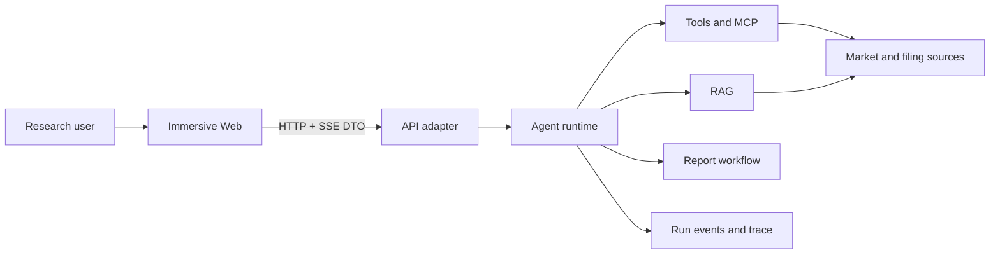

# Immersive Architecture

## 1. Goals

Immersive is a financial-research Agent workspace. The architecture optimizes for explainable runs, replaceable data/model adapters, structured failures, and small task-local context for human and AI contributors.

## 2. System Context

## 3. Dependency Direction

- `apps/web` depends only on browser libraries and `@aiagent/types`.
- `apps/api` is a transport/composition adapter. It may compose runtime packages but must not implement Agent, RAG, tool, workflow, or report rules.
- `packages/agent` owns an end-to-end research run and coordinates report-mode execution.
- `packages/tools`, `packages/rag`, `packages/workflow`, and `packages/report` own their bounded contexts.
- `packages/trace` owns event recording, sanitization, subscription, and trace projections.
- `packages/types` owns transport contracts only and has no runtime dependencies.
- Packages import other packages through declared public entrypoints. Deep cross-package imports and dependency cycles are forbidden.

## 4. Internal Package Shape

Large bounded-context packages use these responsibilities when needed:

- `domain`: stable concepts, invariants, and policies.
- `application`: use cases and ports.
- `adapters`: replaceable infrastructure such as in-memory stores, providers, and renderers.
- package entrypoint: the smallest supported public API.

The Web is feature-first: `app`, `features`, `entities`, and `shared`. A feature may contain `ui`, `model`, `api`, and `lib`; empty ceremonial folders are not created.

## 5. Runtime View

1. Web creates a run through the API.
2. API route delegates creation to `RunApplicationService`; the current adapter writes a bounded in-memory snapshot.
3. The application service schedules execution and Agent/Report emit one canonical, sanitized event stream.
4. Trace storage and SSE subscribers consume the same events.
5. Web projects events into assistant-message progress and an on-demand detail panel.
6. A terminal event provides the final structured result. Explicit cancellation propagates through an execution registry owned `AbortSignal`.
7. `RunStore`, `RunEventBus`, and `RunScheduler` are separate ports so persistence and workers can replace process-local adapters independently.

## 6. Quality Attributes

- Explainability: every meaningful model, retrieval, tool, workflow, approval, and artifact transition is observable.
- Safety: untrusted inputs are validated, sensitive values are redacted, and approvals bind to run and input digest.
- Replaceability: provider-specific behavior stays behind ports and adapters.
- Evolvability: dependency rules, strict types, tests, and documentation checks prevent architecture drift.
- Demo honesty: mock data is labelled and never presented as live market data.

## 7. Decisions and Risks

Architecture-significant decisions live in `docs/decisions/`. The current runtime and artifact stores are process-local; restart loses runs and generated artifacts. RAG document ingestion lineage (documents, versions, chunks) is persisted in PostgreSQL via `0050_rag_documents.sql`, while the vector index remains an in-process store. Real persistence for runs and artifacts, authentication, and licensed market-data providers remain production follow-ups.
